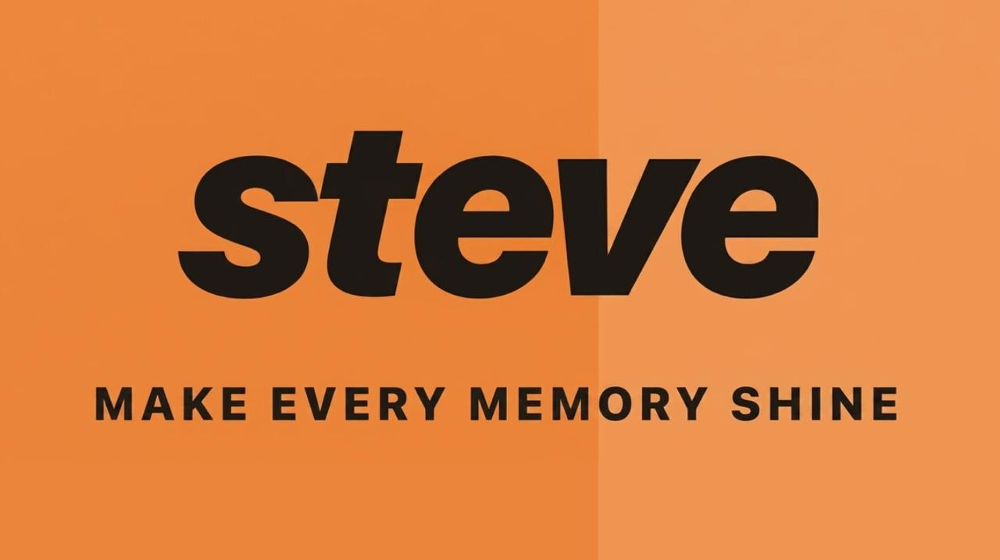
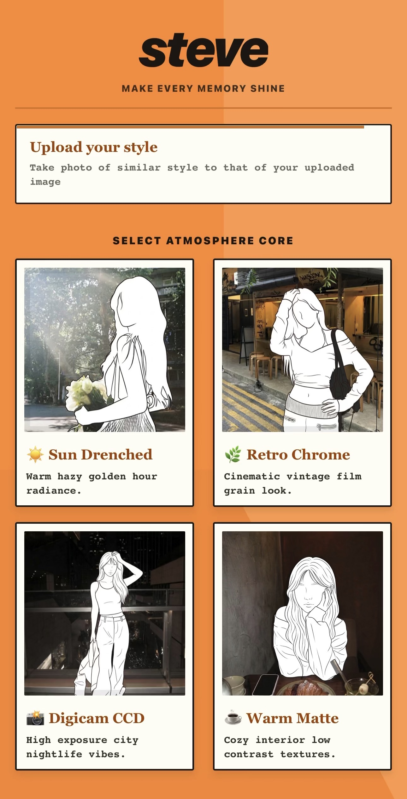
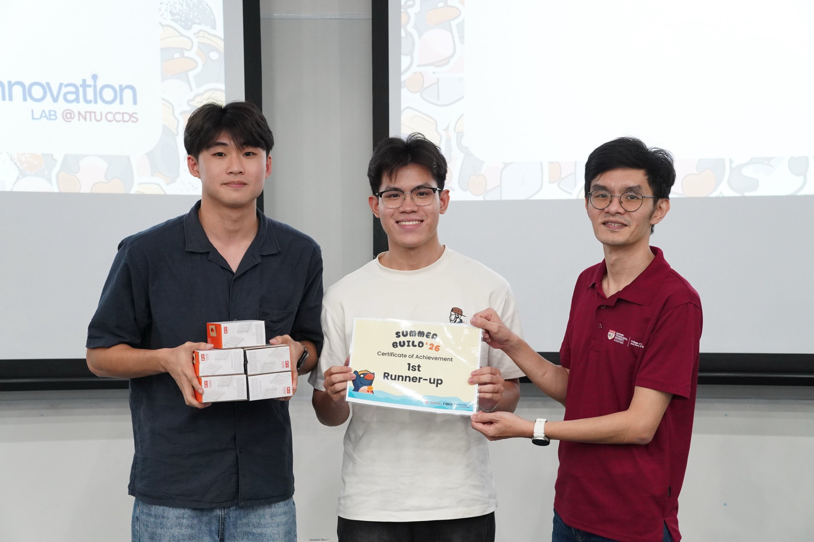

<p align="center">
  
</p>

<p align="center">
  <b>An AI photography coach that helps you take the photo you actually wanted.</b>
</p>

<p align="center">
  <i>First Runner-Up, SummerBuild 2026 — Innovation Lab @ NTU CCDS</i>
</p>

---

## The idea

Most camera apps tell you what went wrong after you've taken the shot. By then the moment
is gone.

STEVE moves the feedback to where it's useful: **while you're still framing**. You pick an
aesthetic — or upload a photo whose look you want to match — and it coaches you live, one
instruction at a time, until the shot is right.

<p align="center">
  
</p>

Four built-in looks ship with the app:

| | |
|---|---|
| **Sun Drenched** | Warm hazy golden-hour radiance |
| **Retro Chrome** | Cinematic vintage film grain |
| **Digicam CCD** | High-exposure city nightlife |
| **Warm Matte** | Cozy interior, low contrast |

Or upload any reference image and STEVE will coach you toward that style instead.

## How it works

A React Native client talks to a Node backend, which wraps a vision-language model behind
two endpoints with very different jobs.

**Live coaching** is latency-constrained. It returns exactly **one** actionable instruction —
"step back and lower the camera", not a paragraph — because anything longer is useless to
someone holding a phone up at arm's length.

**Post-capture** is not latency-constrained, so it returns structured JSON across three axes:
camera settings, pose, and expression. That's where the detailed feedback lives.

Two design decisions did most of the work in making it usable:

- **A salvage layer for malformed model output.** Language models don't always return the
  JSON you asked for. Rather than failing, the backend extracts what it can from the response.
- **Graceful degradation.** If the model API is slow or down, the client returns usable
  generic guidance with a success status — never a network error. In a live demo, a spinner
  that never resolves is worse than an imperfect answer.

## Stack

| Layer | |
|---|---|
| Mobile client | React Native (Expo) |
| Backend | Node.js, Express |
| Vision | Reka vision-language model API |

## Running it locally

**Backend**

```bash
cd backend
cp .env.example .env     # add your own REKA_API_KEY
npm install
npm start                # defaults to port 5001
```

**Frontend**

```bash
cd frontend
npm install
npx expo start
```

Point the client at your backend's address, then scan the QR code with Expo Go.

## Built at SummerBuild 2026

Six weeks, a team of four, and a hackathon run by the Innovation Lab at NTU's College of
Computing and Data Science. Three of the four of us had never done a hackathon before.

<p align="center">
  
</p>

**First Runner-Up out of 24 teams.**

## Team

- [Lee Kok Peng](https://github.com/legoleekokpeng) — team lead, mobile client, model integration
- _(add your teammates here)_

## Status

STEVE was built for a hackathon and is not maintained as a product. The code is here because
the ideas in it — moving feedback before the shutter instead of after, and designing an
integration that stays usable when the model misbehaves — turned out to be the interesting
part.
